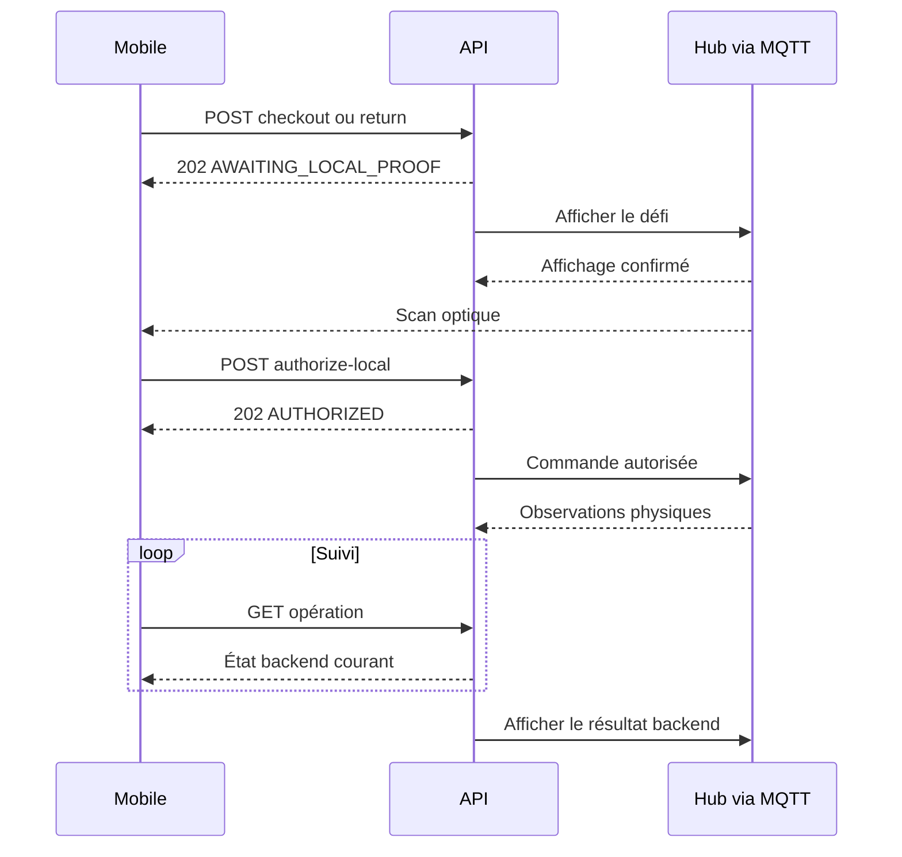

# Aegis — Contrats REST détaillés

**Cours :** 420-5X7-SO — Écosystème connecté  
**Équipe :** Philippe Jordan Monfouayi Mba et Yoël Jimmy Razafindretsa  
**Date de révision :** 23 septembre 2026
**Version :** 1.3 — décisions logicielles P0 et données de suivi des clients  
**Mise à jour ciblée :** 21 octobre 2026 — `Retry-After` de la connexion (§10.2) et langue de la requête (§6.4), comportement existant documenté (#80)  
**Mise à jour ciblée :** 21 octobre 2026 — idempotence REST durable : contenu d’une réponse rejouée (§6.2, §20.2), attente bornée d’une clé en cours et code `IDEMPOTENCY_REQUEST_IN_PROGRESS` (§20.2, §21) (#64)  
**Mise à jour ciblée :** 21 octobre 2026 — présence obligatoire des champs nullables du catalogue et violation `REQUIRED` (§12.1, §12.2) (#25), approuvée le 22 octobre 2026  
**Mise à jour ciblée :** 22 octobre 2026 — catalogue administrateur décidé par Philippe (#25) : codes de violation (§7.1), `archivedAt` et `AssetModelView` (§8.9, §12.1), lectures paginées, unicités, refus d’une ressource archivée et archivage répété (§12.1, §12.2), codes `409` du catalogue (§21), caractères de contrôle (§23.2), tests (§26.6); comportement existant documenté  
**Mise à jour ciblée :** 22 octobre 2026 — sens commun de `reservedUntil` et `dueAt` (§8.4, §14.1), valeurs et conditions de `availableActions` (§8.10, §26.8), règles approuvées par Philippe le 22 octobre 2026; aucun champ ajouté, règles de retour et d’annulation inchangées; deux questions restent ouvertes (§8.10) (#35)  
**Mise à jour ciblée :** 28 octobre 2026 — identifiants et placement (#26), décisions du 28 octobre 2026 : un identifiant actif par type et remplacement atomique, révocation à l’archivage, comparaison exacte des valeurs (§12.2, §12.3), refus du placement et codes `COMPARTMENT_*` (§12.4, §21)

---

## 1. Rôle du document

Ce document fixe le contrat HTTPS entre :

- Aegis Mobile, développé en SwiftUI;
- Aegis Manager, développé en React;
- Aegis Control, développé avec Spring Boot.

Il traduit le scope et les documents 03 à 08 en routes, autorisations, représentations JSON, statuts HTTP et erreurs stables. Il ne décrit pas les messages MQTT, qui possèdent leur propre contrat.

En cas de contradiction, l’ordre de priorité est :

1. le scope validé;
2. les ADR acceptés;
3. le présent contrat;
4. les documents 03 à 08;
5. l’implémentation.

L’implémentation ne devient jamais la nouvelle référence par accident. Toute divergence observée doit être corrigée dans le code ou approuvée et reportée dans le contrat.

---

## 2. Principes obligatoires

1. Le backend Spring Boot est la seule autorité métier.
2. Le Web et iOS expriment des intentions; ils ne calculent ni ne forcent la readiness.
3. Aucun endpoint ne permet de déclarer directement un prêt terminé, une opération confirmée ou une anomalie résolue.
4. Un retrait ou un retour est asynchrone : la requête crée une LockerOperation, puis le client suit son état.
5. Les clients ne reçoivent aucun payload MQTT brut.
6. Les mutations sensibles sont idempotentes.
7. Les contrôles d’autorisation s’effectuent côté serveur sur chaque requête.
8. Un technicien ne peut lire que ses réservations, prêts et opérations.
9. Une ressource appartenant à un autre technicien est présentée comme introuvable afin d’éviter son énumération.
10. Les erreurs métier utilisent des codes stables indépendants du texte affiché.

---

## 3. Conventions générales

| Élément | Convention |
|---|---|
| URL de base | /api/v1 |
| Transport | HTTPS hors environnement local |
| Requête et réponse | application/json; charset=utf-8 |
| Erreur | application/problem+json |
| Noms JSON | camelCase |
| Identifiants | UUID sous forme de chaîne |
| Instants | RFC 3339 en UTC, par exemple 2026-09-16T14:30:00Z |
| Dates locales | Non utilisées dans les décisions métier |
| Heures d’exploitation | HH:mm:ss interprété dans le timeZone de l’horaire |
| Jour de semaine | MONDAY à SUNDAY |
| Valeur absente | Champ omis ou null uniquement lorsque le schéma l’autorise |
| Version majeure | Dans le chemin; une rupture exige /api/v2 |
| Taille de page | 20 par défaut, 100 maximum |

Les champs inconnus d’une requête sont rejetés avec VALIDATION_ERROR. Cette règle évite qu’une faute de frappe soit silencieusement ignorée.

Les clients doivent tolérer l’ajout de nouveaux champs dans une réponse v1. Ils ne doivent pas tolérer une valeur inconnue d’une énumération contrôlant un workflow : elle est journalisée et affichée comme état indisponible jusqu’à la mise à jour du client.

---

## 4. Authentification et contexte de sécurité

### 4.1 Jeton d’accès P0

Après une connexion réussie, le backend émet un JWT signé et expirable, conformément à l’ADR-007 accepté le 23 septembre :

- le client le traite comme une chaîne opaque;
- sa durée P0 est de 60 minutes;
- il transporte au minimum userId, role, maximumAccessLevel, issuedAt, expiresAt et un identifiant de jeton;
- aucun refresh token n’est émis dans le P0;
- l’expiration du jeton n’altère jamais une réservation ou un prêt existant;
- l’utilisateur se reconnecte après expiration.

Spring Security vérifie la signature, l’algorithme explicitement autorisé, l’émetteur, le destinataire et la validité temporelle. L’algorithme, la gestion des clés et le mapping des claims techniques doivent être consignés au bootstrap avant la première connexion réelle. Ils ne deviennent pas une dépendance du code des clients. L’état actif du compte, son rôle et ses droits courants sont vérifiés côté serveur sur les requêtes protégées; un ancien claim ne conserve pas un droit retiré.

### 4.2 Stockage côté client

| Client | Règle |
|---|---|
| iOS | Jeton stocké dans le Keychain; jamais dans UserDefaults. |
| Web | Jeton conservé en mémoire; jamais dans localStorage ou sessionStorage. |
| Tous | Jeton supprimé localement lors de la déconnexion. |

La déconnexion locale ne révoque pas immédiatement une copie du JWT. Ce compromis P0 est explicite : un jeton copié reste utilisable jusqu’à son expiration, sous réserve des contrôles courants du compte. Le rechargement du Web impose une reconnexion. L’expiration ne suspend ni les délais ni le traitement d’une opération physique déjà autorisée.

### 4.3 En-tête

```http
Authorization: Bearer <access-token>
```

Une absence de jeton, un jeton invalide ou expiré produit 401. Un jeton valide sans rôle ou droit suffisant produit 403.

### 4.4 Profil minimal

| Champ | Type | Requis | Valeurs ou règle |
|---|---|---:|---|
| id | UUID | oui | Identifiant utilisateur |
| displayName | string | oui | 1 à 120 caractères |
| email | string | oui | Adresse normalisée |
| role | string | oui | ADMIN ou TECHNICIAN |
| maximumAccessLevel | string | oui | STANDARD ou RESTRICTED |

---

## 5. Autorisations

| Capacité | Public | TECHNICIAN | ADMIN |
|---|---:|---:|---:|
| Santé minimale de l’API | oui | oui | oui |
| Connexion | oui | oui | oui |
| Profil courant | non | oui | oui |
| Catalogue technicien et readiness personnelle | non | oui | non |
| Créer ou annuler sa réservation | non | oui | non |
| Demander retrait ou retour | non | oui | non |
| Lire sa réservation, son prêt et ses opérations | non | oui | non |
| Lire le statut utile du locker | non | oui | oui |
| Administrer modèles, actifs, tags et placements | non | non | oui |
| Lire le diagnostic opérationnel des actifs, sans readiness personnelle | non | non | oui |
| Administrer les horaires | non | non | oui |
| Lire toutes les réservations, prêts et opérations | non | non | oui |
| Lire et reconnaître les anomalies | non | non | oui |
| Lire l’audit | non | non | oui |
| Forcer READY, CONFIRMED, COMPLETED ou RESOLVED | non | non | non |

Un compte ADMIN n’est pas implicitement un technicien. Les comptes de démonstration utilisent des rôles distincts.

---

## 6. En-têtes transversaux

### 6.1 Corrélation

Le client peut envoyer :

```http
X-Request-Id: 5f4bc22e-66a4-48ef-8bf3-6e7184d71c30
```

Le backend retourne toujours un X-Request-Id valide. Il réutilise celui du client lorsqu’il est valide, sinon il en génère un. Cet identifiant apparaît dans les logs et dans traceId des erreurs.

### 6.2 Idempotence

Les routes indiquées comme sensibles exigent :

```http
Idempotency-Key: aac9e0c9-1bb4-48d4-8b55-ccf75a9a73d7
```

La clé :

- contient de 1 à 128 caractères;
- est unique pour l’utilisateur et la route logique;
- est conservée au moins 24 heures;
- doit être réutilisée lorsque le client répète exactement la même intention.

Une réponse rejouée ajoute :

```http
Idempotency-Replayed: true
```

Elle reprend le statut, le contenu JSON et les en-têtes stables de la réponse originale (§20.2). Son `X-Request-Id` reste celui de la tentative courante (§6.1). Une première exécution ne porte jamais `Idempotency-Replayed`.

### 6.3 Localisation d’une nouvelle ressource

Une réponse 201 ou 202 retourne Location lorsque la ressource possède une route de lecture.

### 6.4 Langue de la requête

Un client peut envoyer `Accept-Language`; iOS le fait automatiquement. L’API ne
modifie selon cet en-tête ni son comportement, ni le statut, ni les codes d’erreur
ou de violation, ni ses en-têtes. Les clients affichent leurs propres messages à
partir des codes et n’affichent jamais `detail` (voir la convention de
localisation, `docs/localisation/convention.md`).

---

## 7. Représentation des erreurs

Toutes les erreurs suivent cette structure :

```json
{
  "type": "https://aegis.local/problems/asset-not-ready",
  "title": "Actif non prêt",
  "status": 422,
  "code": "ASSET_NOT_READY",
  "detail": "L'actif ne peut pas être réservé dans son état actuel.",
  "instance": "/api/v1/reservations",
  "traceId": "5f4bc22e-66a4-48ef-8bf3-6e7184d71c30",
  "timestamp": "2026-09-16T14:30:00Z",
  "reasons": ["CALIBRATION_EXPIRED"],
  "violations": []
}
```

| Champ | Type | Requis | Rôle |
|---|---|---:|---|
| type | URI | oui | Catégorie stable du problème |
| title | string | oui | Libellé court localisable |
| status | integer | oui | Statut HTTP |
| code | string | oui | Code applicatif stable |
| detail | string | oui | Explication sûre pour le client |
| instance | string | oui | Chemin de la requête |
| traceId | UUID/string | oui | Corrélation de diagnostic |
| timestamp | instant | oui | Heure backend |
| reasons | string[] | non | Raisons métier contrôlées |
| violations | array | non | Erreurs champ par champ |

Une violation contient field, code et message. Elle ne contient jamais la valeur d’un mot de passe, d’un jeton ou d’un secret.

### 7.1 Codes de violation

`code` est un identifiant stable en majuscules. `message` est un texte de diagnostic en français : un client ne l’affiche jamais tel quel et n’en déduit aucune règle (convention de localisation, `docs/localisation/convention.md`). Codes émis au P0 :

| Code | Sens |
|---|---|
| REQUIRED | Champ exigé absent du corps; un champ `string ou null` ou `instant ou null` doit figurer, `null` compris (§12.1) |
| NOT_NULL | Valeur obligatoire absente ou `null` |
| NOT_BLANK | Texte obligatoire absent, vide ou fait d’espaces |
| NOT_EMPTY | Valeur obligatoire vide (mot de passe de connexion) |
| SIZE | Longueur hors des bornes, y compris une recherche `q` vide après retrait des espaces |
| MAX_UTF8_BYTES | Taille en octets UTF-8 dépassée (mot de passe de connexion) |
| EMAIL | Adresse courriel invalide |
| INVALID_VALUE | Type, format ou valeur d’énumération invalide, paramètre de requête invalide (`page`, `size`, `sort`, `q`), caractère non autorisé (§23.2) |
| UNKNOWN_FIELD | Champ inconnu dans le corps (§3) |
| MALFORMED_BODY | Corps absent ou JSON invalide; `field` vaut `body` |
| ASSET_MODEL_NOT_ACTIVE | `assetModelId` introuvable ou archivé (§12.2) |
| REQUIRED_WHEN_CALIBRATION_REQUIRED | `calibrationDueAt` est `null` alors que `calibrationRequired=true` |
| NOT_ALLOWED_WITHOUT_CALIBRATION | `calibrationDueAt` est fourni alors que `calibrationRequired=false` |

Un client traite un code de violation inconnu de façon générique : un message contrôlé pour le champ nommé, ou pour le formulaire si le champ lui est inconnu, avec le `traceId`. Un nouveau code de violation n’est pas une rupture de la v1.

Le nombre de violations d’une réponse n’est pas contractuel. Une erreur de lecture du corps (`MALFORMED_BODY`, `UNKNOWN_FIELD`, `REQUIRED`, `INVALID_VALUE` de type) est signalée seule, la première trouvée. Les violations de validation d’un corps lisible sont signalées ensemble, triées par champ puis par code. Une règle qui dépend de plusieurs champs ou de la base (`ASSET_MODEL_NOT_ACTIVE`, paire de calibration) n’est vérifiée qu’après elles. Un client ne suppose donc jamais que la liste reçue est exhaustive.

---

## 8. Représentations communes

### 8.1 ReadinessAssessment

| Champ | Type | Requis |
|---|---|---:|
| assetId | UUID | oui |
| evaluatedForUserId | UUID | oui |
| result | READY, BLOCKED ou UNKNOWN | oui |
| reasons | ReadinessReason[] | oui |
| evaluatedAt | instant | oui |

ReadinessReason :

- NOT_PRESENT;
- NOT_AVAILABLE;
- MAINTENANCE;
- DAMAGED;
- CALIBRATION_EXPIRED;
- ACCESS_DENIED;
- UNKNOWN_PHYSICAL_STATE.

Plusieurs raisons peuvent coexister. READY exige un tableau reasons vide.

### 8.2 AssetView du technicien

| Champ | Type | Requis |
|---|---|---:|
| id | UUID | oui |
| assetCode | string | oui |
| model | AssetModelSummary | oui |
| requiredAccessLevel | AccessLevel | oui |
| operationalStatus | SERVICEABLE, MAINTENANCE ou DAMAGED | oui |
| calibration | CalibrationView | oui |
| availability | AVAILABLE, RESERVED, BORROWED ou UNAVAILABLE | oui |
| presence | PRESENT, ABSENT ou UNKNOWN | oui |
| readiness | ReadinessAssessment | oui |
| placement | PlacementSummary ou null | oui |

Le technicien ne reçoit jamais identifierValue, le payload RFID brut, le mot de passe MQTT ou des détails sur un autre titulaire.

Exemple :

```json
{
  "id": "300e72fd-118c-4d1f-af9c-7fb61e89f62c",
  "assetCode": "MM-001",
  "model": {
    "id": "a09aa622-fba1-4457-8f67-7f123284e132",
    "name": "Multimètre 1",
    "manufacturer": "Fluke",
    "modelNumber": "117"
  },
  "requiredAccessLevel": "STANDARD",
  "operationalStatus": "SERVICEABLE",
  "calibration": {
    "required": true,
    "dueAt": "2026-12-01T05:00:00Z",
    "status": "VALID"
  },
  "availability": "AVAILABLE",
  "presence": "PRESENT",
  "readiness": {
    "assetId": "300e72fd-118c-4d1f-af9c-7fb61e89f62c",
    "evaluatedForUserId": "75acc15f-fc23-45d9-857d-b543694e4fc2",
    "result": "READY",
    "reasons": [],
    "evaluatedAt": "2026-09-16T14:30:00Z"
  },
  "placement": {
    "lockerId": "d46a74ae-39dc-460b-8af0-38fc791b376a",
    "lockerCode": "AEGIS-DEMO-01",
    "compartmentId": "1ae77ae3-8490-4f09-9412-a7816b77bff9",
    "compartmentCode": "A1"
  }
}
```

### 8.3 ReservationView

| Champ | Type | Requis |
|---|---|---:|
| id | UUID | oui |
| asset | AssetSummary | oui |
| userId | UUID | oui |
| status | ACTIVE, FULFILLED, CANCELLED ou EXPIRED | oui |
| reservedFrom | instant | oui |
| reservedUntil | instant | oui |
| createdAt | instant | oui |
| cancelledAt | instant ou null | oui |
| fulfilledAt | instant ou null | oui |
| expiredAt | instant ou null | oui |
| currentOperationId | UUID ou null | oui |
| availableActions | string[] | oui |

### 8.4 LoanView

| Champ | Type | Requis |
|---|---|---:|
| id | UUID | oui |
| asset | AssetSummary | oui |
| holderUserId | UUID | oui |
| status | ACTIVE, RETURN_PENDING ou COMPLETED | oui |
| checkedOutAt | instant | oui |
| dueAt | instant | oui |
| overdue | boolean | oui |
| returnRequestedAt | instant ou null | oui |
| returnedAt | instant ou null | oui |
| checkoutOperationId | UUID | oui |
| returnOperationId | UUID ou null | oui |
| currentOperationId | UUID ou null | oui |
| availableActions | string[] | oui |

`currentOperationId` est une référence de suivi calculée, pas un nouvel état métier. Pour une réservation `ACTIVE`, elle désigne sa dernière tentative de retrait; pour un prêt `ACTIVE` ou `RETURN_PENDING`, sa dernière tentative de retour. Elle reste renseignée si cette tentative est terminale, afin d’expliquer un échec ou une anomalie. Elle vaut `null` sans tentative ou lorsque la réservation/le prêt est clos. Une opération non terminale liée est prioritaire. La lecture utilise les mêmes contrôles de propriété que la ressource parente.

`returnOperationId` conserve son sens historique : il désigne uniquement le retour **confirmé**, conformément au modèle logique. Il ne sert pas à retrouver une tentative en cours. Les références de suivi sont dérivées des relations existantes, sans colonne SQL supplémentaire imposée.

`dueAt` est la copie de `Reservation.reservedUntil` faite à la confirmation du retrait (§14.1). Il n’est ni saisi ni recalculé par un client.

Les valeurs et les conditions de `availableActions` des vues §8.3 et §8.4 sont fixées en §8.10.

### 8.5 LockerOperationView

| Champ | Type | Requis |
|---|---|---:|
| id | UUID | oui |
| type | CHECKOUT ou RETURN | oui |
| status | LockerOperationStatus | oui |
| userId | UUID | oui |
| assetId | UUID | oui |
| lockerId | UUID | oui |
| compartmentId | UUID | oui |
| reservationId | UUID ou null | oui |
| loanId | UUID ou null | oui |
| createdAt | instant | oui |
| authorizedAt | instant ou null | oui |
| localAccessChallengeId | UUID ou null | oui |
| localProofExpiresAt | instant ou null | oui |
| localProofDisplayedAt | instant ou null | oui |
| localProofValidatedAt | instant ou null | oui |
| requiredAction | SCAN_HUB_QR, WAIT ou NONE | oui |
| expiresAt | instant ou null | oui |
| commandSentAt | instant ou null | oui |
| acknowledgedAt | instant ou null | oui |
| doorOpenedAt | instant ou null | oui |
| observationReceivedAt | instant ou null | oui |
| confirmedAt | instant ou null | oui |
| terminalAt | instant ou null | oui |
| failureReason | string ou null | oui |
| anomalyId | UUID ou null | oui |

LockerOperationStatus :

- REQUESTED;
- AWAITING_LOCAL_PROOF;
- AUTHORIZED;
- COMMAND_SENT;
- COMMAND_ACKNOWLEDGED;
- DOOR_OPENED;
- OBSERVATION_RECEIVED;
- CONFIRMED;
- FAILED;
- EXPIRED;
- ANOMALY.

### 8.6 LockerStatusView

| Champ | Type | Requis |
|---|---|---:|
| lockerId | UUID | oui |
| code | string | oui |
| name | string | oui |
| topology | MONOLITHIC ou HUB_CELL | oui |
| connectionStatus | ONLINE, OFFLINE ou UNKNOWN | oui |
| lastSeenAt | instant ou null | oui |
| evaluatedAt | instant | oui |
| currentWindow | OperatingWindowView | oui |
| compartments | CompartmentStatusView[] | oui |

Un CompartmentStatusView contient id, code, enabled, connectionStatus, rfidReaderStatus, doorState, lockState et lastObservedAt. Il ne contient pas de message MQTT brut.

`OperatingWindowView` fournit `timeZone` (identifiant IANA), `open` (booléen), `closesAt` (instant UTC ou null) et `nextOpensAt` (instant UTC ou null), calculés par le serveur à `evaluatedAt`. Quand la plage est ouverte, `closesAt` est son échéance et `nextOpensAt` vaut null. Quand elle est fermée, `closesAt` vaut null et `nextOpensAt` indique la prochaine ouverture, ou null si aucune n’est configurée. Sans horaire exploitable, `open=false` et les deux instants valent null. Ces données permettent l’affichage et la sélection d’une échéance; elles n’autorisent jamais une action sans revalidation serveur.

### 8.7 AnomalyView

| Champ | Type | Requis |
|---|---|---:|
| id | UUID | oui |
| type | AnomalyType | oui |
| severity | LOW, MEDIUM ou HIGH | oui |
| status | OPEN, ACKNOWLEDGED ou RESOLVED | oui |
| lockerOperationId | UUID ou null | oui |
| assetId | UUID ou null | oui |
| compartmentId | UUID ou null | oui |
| detectedAt | instant | oui |
| acknowledgedAt | instant ou null | oui |
| acknowledgedBy | UserSummary ou null | oui |
| acknowledgementNote | string ou null | oui |
| resolvedAt | instant ou null | oui |
| resolutionEvidenceObservationId | UUID ou null | oui |
| resolutionNote | string ou null | oui |
| summary | string | oui |

Les détails techniques sensibles ne sont inclus que dans la vue de détail administrateur.

### 8.8 Résumés d’identité

`AssetSummary` contient `id` (UUID), `assetCode` (string), `model` (le résumé de modèle de §8.2) et `placement` (le résumé de placement de §8.2 ou null). Il ne contient ni identifiant RFID brut ni readiness supposée courante. `UserSummary` contient seulement `id` (UUID) et `displayName` (string). Un résumé n’accorde aucun droit de lecture supplémentaire.

### 8.9 AdminAssetView et diagnostic opérationnel

La vue administrative reprend les champs de `AssetView` de §8.2 **sauf `readiness`**, et ajoute `serialNumber` (string ou null), `operationalDiagnostic` et `archivedAt` (instant ou null : l’instant de l’archivage, `null` pour un actif actif). `operationalDiagnostic` contient `evaluatedAt` (instant) et `reasons` (tableau des raisons de §8.1, sauf `ACCESS_DENIED`). Il expose les empêchements non personnels connus : disponibilité, état de service, calibration et présence physique. Une réservation active rend l’actif indisponible dans cette vue générale, sans empêcher le retrait autorisé de son titulaire.

Ce diagnostic n’invente ni technicien de référence ni résultat `READY` universel. Un tableau vide signifie seulement « aucun empêchement non personnel détecté ». Il ne prouve ni le droit d’un utilisateur ni la possibilité d’ouvrir le casier. L’administrateur ne reçoit pas de `canCheckout` et ne se substitue pas au technicien. L’horaire et la santé du casier restent consultables via leurs vues dédiées.

### 8.10 Actions permises (`availableActions`)

`availableActions` liste les mutations métier que le serveur estime admissibles pour le demandeur **au moment où il construit la réponse**, d’après l’état qu’il connaît. C’est une indication d’affichage, jamais une autorisation durable : chaque mutation revalide toutes ses gardes dans sa propre transaction et peut être refusée si l’état a changé depuis la lecture (`409`, `422` ou `503`). Ces règles ont été approuvées par Philippe le 22 octobre 2026; les deux questions ouvertes en fin de section ne le sont pas.

Le serveur n’émet que les valeurs suivantes; leur ordre n’a pas de sens et chacune apparaît au plus une fois. `CHECKOUT` correspond à « Préparer le retrait », `CANCEL` à « Annuler la réservation » et `RETURN` à « Retourner l’équipement ». « Réserver », c’est-à-dire créer la réservation (§14.1), n’a pas de valeur : ce bouton suit la readiness de l’actif (§8.1). Un casier hors ligne n’y produit donc pas le même refus : la création voit une readiness `UNKNOWN` et répond `422 ASSET_NOT_READY` (`06` §4.4, §5.1), tandis que la préparation d’un retrait ou d’un retour se heurte à la garde du locker et répond `503 LOCKER_OFFLINE` (`06` §6.1; §21, §26.5). Le `422 ASSET_NOT_READY` ne concerne que la création.

| Valeur | Vue | Mutation | Conditions, toutes vraies à l’évaluation |
|---|---|---|---|
| `CHECKOUT` | `ReservationView` | `POST /reservations/{id}/checkout` (§15.1) | Réservation `ACTIVE` du demandeur; instant antérieur à `reservedUntil`; plage d’exploitation ouverte; aucune opération physique non terminale sur le locker, y compris une tentative de cette réservation; garde commune du locker satisfaite (`06` §6.1), donc hub `ONLINE`; readiness `READY` dans le contexte du retrait du titulaire (`06` §6.2). |
| `CANCEL` | `ReservationView` | `POST /reservations/{id}/cancel` (§14.4) | Réservation `ACTIVE` du demandeur; instant antérieur à `reservedUntil`; aucune tentative de retrait de cette réservation n’a été autorisée, quelle que soit son issue (§14.4, `06` §5.5; question ouverte Q1); aucune incertitude physique, c’est-à-dire aucune tentative `ANOMALY` dont l’anomalie n’est pas `RESOLVED`. Une tentative `AWAITING_LOCAL_PROOF` laisse `CANCEL` : l’annulation la termine (§14.4). L’horaire et la connexion du locker n’interviennent pas. |
| `RETURN` | `LoanView` | `POST /loans/{id}/return` (§15.2) | Prêt `ACTIVE` du titulaire; plage d’exploitation ouverte; aucune opération physique non terminale sur le locker, y compris une tentative de ce prêt; gardes communes et de retour satisfaites (`06` §6.1, §6.3), donc hub `ONLINE`. `overdue` n’intervient pas. |

À partir de `reservedUntil`, une réservation encore `ACTIVE` (expiration différée par un retrait autorisé, ou pas encore appliquée) n’expose aucune action : les règles temporelles sont réévaluées au début de chaque action (`06` §14). La limitation de fréquence des préparations (§15.5) n’est pas reflétée; elle se manifeste par `429` avec `Retry-After`.

Pour un prêt `RETURN_PENDING`, `05` §4.3 et `06` §6.3 n’admettent une nouvelle tentative de récupération que si l’opération précédente est terminale **et** si la procédure de récupération l’autorise. Cette procédure n’est pas encore définie : tant qu’elle ne l’est pas, `RETURN` n’est pas émis pour un prêt `RETURN_PENDING` (question ouverte Q2). Cette lecture n’ajoute aucune règle de retour.

| Situation lue | `ReservationView` | `LoanView` |
|---|---|---|
| Réservation `ACTIVE` avant `reservedUntil`, aucune tentative de retrait en cours ni autorisée auparavant, plage ouverte, gardes satisfaites | `["CHECKOUT", "CANCEL"]` | — |
| Même cas, mais locker `OFFLINE` ou `UNKNOWN`, cellule, lecteur, porte ou serrure incompatibles, readiness autre que `READY`, plage fermée ou autre opération en cours sur le locker | `["CANCEL"]` | — |
| Dernière tentative de retrait `AWAITING_LOCAL_PROOF` | `["CANCEL"]`, ou `[]` si une tentative précédente a été autorisée (Q1) | — |
| Dernière tentative de retrait entre `AUTHORIZED` et `OBSERVATION_RECEIVED` | `[]` | — |
| Une tentative de retrait a été autorisée puis s’est terminée `FAILED`, `EXPIRED` ou `ANOMALY` résolue; aucune tentative en cours | `["CHECKOUT"]` si les gardes sont satisfaites, sinon `[]`; jamais `CANCEL` (Q1) | — |
| Dernière tentative de retrait `ANOMALY`, anomalie non `RESOLVED` | `[]` | — |
| `reservedUntil` atteint, statut encore `ACTIVE` | `[]` | — |
| Réservation `FULFILLED`, `CANCELLED` ou `EXPIRED` | `[]` | — |
| Prêt `ACTIVE`, en retard ou non, plage ouverte, gardes satisfaites, aucune tentative non terminale | — | `["RETURN"]` |
| Prêt `ACTIVE`, mais locker non `ONLINE`, garde physique incompatible, plage fermée ou autre opération en cours sur le locker | — | `[]` |
| Prêt `ACTIVE`, dernière tentative de retour `AWAITING_LOCAL_PROOF` | — | `[]` |
| Prêt `RETURN_PENDING` (Q2) ou `COMPLETED` | — | `[]` |

Une tentative terminée sans avoir été autorisée (défi expiré ou invalidé) ne change rien : les trois premières lignes s’appliquent. Après un retour terminé sans interaction physique, le prêt est de nouveau `ACTIVE` (`05` §4.3) et les lignes du prêt `ACTIVE` s’appliquent.

Règles pour les clients :

1. Une action métier n’est proposée que si sa valeur figure dans la dernière lecture réussie de la ressource. Le client ne la déduit ni de `status`, ni de la readiness, ni de `LockerStatusView`, et ne la conserve pas comme droit au-delà de cette lecture.
2. Une valeur inconnue est journalisée et ignorée : aucune action n’est proposée pour elle (§3).
3. Les actions locales (actualiser, réessayer, reprendre le suivi, consulter l’équipement ou le casier) ne figurent jamais dans `availableActions` et ne changent aucun état métier. Elles restent disponibles quand la liste est vide. Une liste vide ne signifie ni succès ni fin d’opération : l’issue se lit dans `status` et dans l’opération courante.
4. Une tentative non terminale se reprend par `currentOperationId` (§15.4), sans valeur dédiée ni nouvelle mutation. Le scan du QR dépend de `LockerOperationView.requiredAction = SCAN_HUB_QR`, pas de `availableActions`.
5. Après un refus `409`, `422` ou `503` d’une mutation, le client relit la ressource parente et suit sa nouvelle liste. Un refus antérieur n’est jamais mémorisé comme blocage. Une tentative terminale `FAILED` ou `EXPIRED` ne retire pas à elle seule `CHECKOUT` ou `RETURN` (`06` §3.4).
6. Le client distingue deux situations :
   - **API sans réponse exploitable** (réseau absent, délai dépassé, réponse hors contrat) : aucune lecture fraîche. Le client présente le dernier état reçu comme tel (« Dernier état : … », en couleurs neutres), daté de l’heure locale de sa réception, désactive toutes les actions métier et propose de réessayer. Il ne conclut rien sur l’état du casier.
   - **API joignable, casier indisponible** (hub non `ONLINE`, cellule ou lecteur indisponible) : la lecture est fraîche; `CHECKOUT` et `RETURN` sont absents et `CANCEL` peut rester. Le client peut expliquer l’indisponibilité par `GET /lockers/{lockerId}/status` (§16.1 : `connectionStatus`, `lastSeenAt`, `currentWindow`), avec `lockerId` tiré de `asset.placement`, sans en déduire une permission. Actualiser relit la ressource et ce statut. Un `503` de code `LOCKER_OFFLINE` ou `DEVICE_UNAVAILABLE` relève de cette situation.

Exemples (champs pertinents seulement; les autres champs obligatoires restent présents). Réservation active, locker hors ligne, puis statut du locker :

```json
{
  "id": "7b726e56-2a19-44de-887b-d3e2bfc8bf28",
  "status": "ACTIVE",
  "reservedUntil": "2026-09-16T20:30:00Z",
  "currentOperationId": null,
  "availableActions": ["CANCEL"]
}
```

```json
{
  "connectionStatus": "OFFLINE",
  "lastSeenAt": "2026-09-16T18:28:10Z",
  "evaluatedAt": "2026-09-16T18:31:02Z",
  "currentWindow": {
    "timeZone": "America/Toronto",
    "open": true,
    "closesAt": "2026-09-16T21:00:00Z",
    "nextOpensAt": null
  }
}
```

Retrait autorisé en cours : la carte propose seulement de reprendre le suivi.

```json
{
  "status": "ACTIVE",
  "reservedUntil": "2026-09-16T20:30:00Z",
  "currentOperationId": "2f38d3b6-c18f-4a74-aa9a-2d574286013f",
  "availableActions": []
}
```

Prêt en retard, casier joignable :

```json
{
  "status": "ACTIVE",
  "dueAt": "2026-09-16T20:30:00Z",
  "overdue": true,
  "currentOperationId": null,
  "availableActions": ["RETURN"]
}
```

#### Questions ouvertes (non tranchées)

Ces deux points ne sont pas approuvés. En attendant, la section applique le texte existant sans ajouter de règle.

- **Q1 — Annulation après une tentative de retrait autorisée.** Une tentative autorisée peut se terminer `FAILED`, `EXPIRED` ou en `ANOMALY` résolue sans qu’un prêt naisse.
  - Référence : §14.4, `06` §5.5, `05` §3.3.
  - Lecture appliquée : littérale; `CANCEL` n’est plus émis et l’actif reste réservé jusqu’à `reservedUntil`, qui ne dépasse pas la fermeture.
  - Recommandation : confirmer la lecture littérale pour le P0; l’assouplir serait une nouvelle règle d’annulation.
  - Propriétaires : décision de Philippe; contrat tenu par la session API/Web; mise en œuvre RES-02 (#38).
- **Q2 — Récupération d’un prêt `RETURN_PENDING`.** La procédure qui autorise une nouvelle tentative n’est pas définie.
  - Référence : `05` §4.3, `06` §6.3.
  - Lecture appliquée : `RETURN` n’est pas émis.
  - Recommandation : émettre `RETURN` quand la dernière tentative de retour est `ANOMALY`, que son anomalie est `ACKNOWLEDGED` (`05` §6.2 : correction physique engagée) et que toutes les autres gardes sont satisfaites.
  - Propriétaires : décision de Philippe; contrat tenu par la session API/Web; mise en œuvre RET-01 (#50) et ANO-01 (#52).

---

## 9. Catalogue des endpoints

### 9.1 Public et profil

| Méthode | Route | Accès | Résultat |
|---|---|---|---|
| GET | /system/health | Public | Santé minimale |
| POST | /auth/login | Public | Jeton et profil |
| GET | /auth/me | Authentifié | Profil courant |

### 9.2 Technicien

Route supplémentaire : `POST /locker-operations/{operationId}/authorize-local` — initiateur uniquement, `Idempotency-Key`, réponse 202, détails §15.5.


| Méthode | Route | Résultat |
|---|---|---|
| GET | /assets | Catalogue avec readiness personnelle |
| GET | /assets/{assetId} | Détail avec readiness personnelle |
| POST | /reservations | Créer une réservation |
| GET | /me/reservation | Réservation active du technicien |
| GET | /reservations/{reservationId} | Réservation appartenant au technicien |
| POST | /reservations/{reservationId}/cancel | Annuler une réservation inutilisée |
| POST | /reservations/{reservationId}/checkout | Commencer un retrait |
| GET | /me/loan | Prêt ouvert du technicien |
| GET | /loans/{loanId} | Prêt appartenant au technicien |
| POST | /loans/{loanId}/return | Commencer un retour |
| POST | /locker-operations/{operationId}/authorize-local | Consommer le QR et autoriser l’opération préparée |
| GET | /locker-operations/{operationId} | Progression de sa propre opération |
| GET | /lockers/{lockerId}/status | État utile du locker; accessible au technicien et à l’administrateur (§5, §16.1) |

### 9.3 Administration

| Méthode | Route | Résultat |
|---|---|---|
| GET | /admin/asset-models | Liste des modèles |
| POST | /admin/asset-models | Créer un modèle |
| GET | /admin/asset-models/{modelId} | Détail d’un modèle |
| PUT | /admin/asset-models/{modelId} | Remplacer les champs modifiables |
| POST | /admin/asset-models/{modelId}/archive | Archiver un modèle |
| GET | /admin/assets | Liste administrative des actifs |
| POST | /admin/assets | Créer un actif |
| GET | /admin/assets/{assetId} | Détail administratif |
| PUT | /admin/assets/{assetId} | Remplacer les champs modifiables |
| POST | /admin/assets/{assetId}/archive | Archiver un actif |
| POST | /admin/assets/{assetId}/identifiers | Assigner un identifiant |
| POST | /admin/assets/{assetId}/identifiers/{identifierId}/revoke | Révoquer un identifiant |
| PUT | /admin/assets/{assetId}/placement | Définir le placement attendu |
| GET | /admin/lockers | Liste des lockers |
| GET | /admin/lockers/{lockerId}/operating-schedule | Horaire actif |
| PUT | /admin/lockers/{lockerId}/operating-schedule | Remplacer l’horaire actif |
| GET | /admin/reservations | Réservations filtrées |
| GET | /admin/reservations/{reservationId} | Détail d’une réservation |
| GET | /admin/loans | Prêts filtrés |
| GET | /admin/loans/{loanId} | Détail d’un prêt |
| GET | /admin/locker-operations | Opérations filtrées |
| GET | /admin/locker-operations/{operationId} | Détail d’une opération |
| GET | /admin/anomalies | Anomalies filtrées |
| GET | /admin/anomalies/{anomalyId} | Détail et preuve |
| POST | /admin/anomalies/{anomalyId}/acknowledge | Reconnaître sans résoudre |
| GET | /admin/audit-events | Chronologie paginée |

---

## 10. Santé et authentification

### 10.1 GET /system/health

Réponse 200 :

```json
{
  "status": "UP",
  "service": "aegis-control",
  "version": "0.1.0",
  "timestamp": "2026-09-16T14:30:00Z"
}
```

Cette route ne révèle ni URL interne, ni version PostgreSQL, ni identité MQTT, ni secret. Les sondes détaillées restent internes au déploiement.

### 10.2 POST /auth/login

Requête :

```json
{
  "email": "technician@aegis.demo",
  "password": "mot-de-passe-transitoire"
}
```

Validations :

- email requis, normalisé et limité à 320 caractères;
- password requis et limité en taille avant hachage;
- message identique pour compte absent, désactivé ou mot de passe invalide.

Réponse 200 :

```json
{
  "accessToken": "<opaque-to-client>",
  "tokenType": "Bearer",
  "expiresIn": 3600,
  "expiresAt": "2026-09-16T15:30:00Z",
  "user": {
    "id": "75acc15f-fc23-45d9-857d-b543694e4fc2",
    "displayName": "Technicien Démo",
    "email": "technician@aegis.demo",
    "role": "TECHNICIAN",
    "maximumAccessLevel": "STANDARD"
  }
}
```

Erreurs : 400 VALIDATION_ERROR, 401 AUTH_INVALID_CREDENTIALS, 429 RATE_LIMITED.

Limitation : au plus cinq tentatives par minute pour une même adresse cliente et
un même courriel, sans tenir compte de la casse. Au-delà, la réponse
`429 RATE_LIMITED` porte l’en-tête `Retry-After` en secondes (delta-seconds) :
un entier de 1 à 60, arrondi à la seconde supérieure, jamais une date HTTP. Le
client affiche ce délai une seule fois et seulement à partir d’une valeur valide;
sans valeur valide, il indique seulement qu’il y a eu trop de tentatives.

### 10.3 GET /auth/me

Retourne 200 avec le profil minimal. Cette route permet au client de réhydrater son contexte sans décoder le jeton.

---

## 11. Catalogue technicien et readiness

### 11.1 GET /assets

Paramètres :

| Paramètre | Type | Défaut | Règle |
|---|---|---|---|
| q | string | absent | Recherche sur code et nom, 1 à 100 caractères |
| readiness | enum | absent | READY, BLOCKED ou UNKNOWN |
| availability | enum | absent | AVAILABLE, RESERVED, BORROWED ou UNAVAILABLE |
| page | integer | 0 | Minimum 0 |
| size | integer | 20 | 1 à 100 |
| sort | enum | assetCode,asc | assetCode ou modelName |

Chaque élément est un AssetView évalué pour l’utilisateur authentifié. La réponse inclut evaluatedAt; le client ne réutilise pas une readiness ancienne pour décider une action.

Dans le déploiement mono-institution P0, le catalogue montre les actifs de l’institution, y compris ceux dont le niveau requis dépasse celui du technicien. Ils portent notamment la raison `ACCESS_DENIED`; leur visibilité ne donne aucun droit de réservation. Les données d’un autre titulaire et les identifiants matériels restent exclus.

Réponse :

```json
{
  "items": [],
  "page": 0,
  "size": 20,
  "totalItems": 0,
  "totalPages": 0
}
```

### 11.2 GET /assets/{assetId}

Retourne 200 avec AssetView. Erreurs : 404 ASSET_NOT_FOUND.

La présence d’un actif dans le catalogue ne signifie pas qu’il est réservable. La propriété readiness fournit la décision courante.

---

## 12. Administration du catalogue

### 12.1 AssetModel

CreateAssetModelRequest et UpdateAssetModelRequest :

| Champ | Type | Requis | Validation |
|---|---|---:|---|
| name | string | oui | 1 à 160 caractères |
| manufacturer | string ou null | oui | Maximum 120 |
| modelNumber | string ou null | oui | Maximum 120 |
| description | string ou null | oui | Maximum 2000 |
| defaultCalibrationRequired | boolean | oui | — |

Dans les tables de §12.1 et §12.2, « Requis : oui » signifie que le champ figure dans le corps, même quand il accepte `null`. Un champ omis et un `null` explicite sont distincts :

- un champ `string ou null` ou `instant ou null` omis est refusé par `400 VALIDATION_ERROR` avec la violation `{field, code: REQUIRED}`; un `null` explicite est accepté et vide la valeur;
- un champ non nullable omis ou `null` est refusé avec `NOT_NULL`, ou `NOT_BLANK` pour un texte;
- l’ordre et le regroupement des violations suivent §7.1.

Ce comportement est celui de la tranche CAT-01 (décision de Philippe, 22 octobre 2026); son extension aux autres routes n’est pas décidée ici.

Les textes sont débarrassés de leurs espaces extérieurs; un texte facultatif vide devient `null`.

AssetModelView, réponse de toutes les routes de modèles :

| Champ | Type | Rôle |
|---|---|---|
| id | UUID | Identifiant |
| name | string | Nom |
| manufacturer | string ou null | Fabricant |
| modelNumber | string ou null | Numéro de modèle |
| description | string ou null | Description |
| defaultCalibrationRequired | boolean | Calibration exigée par défaut |
| archivedAt | instant ou null | Instant de l’archivage |

GET /admin/asset-models retourne une page de `AssetModelView` (paramètres `page` et `size` de §11.1, enveloppe de §11.1), triée par nom sans casse puis par `id`. Les modèles archivés y figurent.

Le nom d’un modèle est unique sans casse parmi les modèles non archivés : un conflit retourne `409 ASSET_MODEL_NAME_ALREADY_EXISTS`. Un modèle archivé libère son nom.

POST /admin/asset-models retourne 201 et exige Idempotency-Key.

PUT /admin/asset-models/{modelId} retourne 200. Un PUT identique est un no-op métier et ne crée pas un second événement ASSET_UPDATED. Un modèle archivé ne se modifie plus : `409 ASSET_MODEL_ARCHIVED`.

POST /admin/asset-models/{modelId}/archive retourne 200. Il est refusé avec 409 ASSET_MODEL_IN_USE si un actif non archivé l’utilise. Un modèle déjà archivé suit la règle d’archivage répété ci-dessous.

**Archivage répété** (modèle et actif). Archiver une ressource déjà archivée retourne `200` sans nouveau changement métier : `archivedAt` est conservé et aucune donnée n’est réécrite. Avec la même Idempotency-Key, la réponse initiale est rejouée (§20.2). Avec une nouvelle clé, la réponse est la représentation courante de la ressource archivée; pour un actif, ses champs dérivés (disponibilité, `operationalDiagnostic` et son `evaluatedAt`) peuvent être réévalués. Comme pour une réservation déjà annulée (§14.4), l’audit enregistre ce cas par un événement `ASSET_ARCHIVED` de résultat `ALREADY_APPLIED`, qui reprend l’`archivedAt` conservé; seul le premier archivage écrit un événement `ACCEPTED`. Le rejeu avec la même clé n’écrit aucun événement.

**Audit du catalogue** (modèle et actif). Une création, une modification effective et un premier archivage écrivent chacun un seul événement d’audit (`ASSET_CREATED`, `ASSET_UPDATED` ou `ASSET_ARCHIVED`, `subjectType` `ASSET_MODEL` ou `ASSET`), dans la transaction de la mutation et avec l’instant qu’elle enregistre. L’acteur est le compte authentifié. Un rejeu de même clé, un PUT identique et une mutation refusée n’en écrivent aucun.

### 12.2 Asset

Les lectures `GET /admin/assets` et `GET /admin/assets/{assetId}` retournent respectivement une page et une instance de `AdminAssetView` (§8.9). La liste conserve l’enveloppe de pagination de §11.1.

`GET /admin/assets` accepte `q`, `page`, `size` et `sort` avec les règles de §11.1, sans les filtres `readiness` et `availability` du technicien. `q` cherche, sans casse, dans `assetCode` et le nom du modèle (§22.3). `sort` vaut `assetCode` ou `modelName`, suivi de `,asc` ou `,desc` (`assetCode,asc` par défaut); l’ordre est stable : `modelName` départage par `assetCode`, puis `id` départage toujours (§22.1). Les actifs archivés y figurent, avec leur `archivedAt`. Une valeur invalide retourne `400 VALIDATION_ERROR` (`SIZE` ou `INVALID_VALUE`, §7.1).

Sur ces lectures du catalogue administrateur seulement (`GET /admin/asset-models` et `GET /admin/assets`), un paramètre de requête inconnu est ignoré. Cette tolérance ne s’étend pas aux autres routes et ne concerne pas les champs d’un corps, toujours refusés (§3). Les réponses de création et de modification emploient la même vue administrative, jamais une readiness calculée pour un administrateur traité comme technicien.

CreateAssetRequest et UpdateAssetRequest :

| Champ | Type | Requis | Validation |
|---|---|---:|---|
| assetModelId | UUID | oui | Modèle actif |
| assetCode | string | oui | 1 à 64, unique sans casse |
| serialNumber | string ou null | oui | Maximum 120 |
| requiredAccessLevel | enum | oui | STANDARD ou RESTRICTED |
| operationalStatus | enum | oui | SERVICEABLE, MAINTENANCE ou DAMAGED |
| calibrationRequired | boolean | oui | — |
| calibrationDueAt | instant ou null | oui | Requis si calibrationRequired=true |

`assetModelId` doit désigner un modèle existant et non archivé, sinon la violation `ASSET_MODEL_NOT_ACTIVE` est retournée. `calibrationDueAt` est requis si `calibrationRequired=true` (`REQUIRED_WHEN_CALIBRATION_REQUIRED`) et refusé sinon (`NOT_ALLOWED_WITHOUT_CALIBRATION`). L’état de calibration est toujours calculé par le backend.

Unicités, archives comprises (règle P0) :

- `assetCode` est unique sans casse : `409 ASSET_CODE_ALREADY_EXISTS`;
- `serialNumber`, lorsqu’il est renseigné, est unique tel quel : `409 ASSET_SERIAL_NUMBER_ALREADY_EXISTS`. Plusieurs actifs peuvent ne pas avoir de numéro.

Un actif archivé garde donc son code et son numéro de série.

POST /admin/assets retourne 201 et exige Idempotency-Key.

PUT /admin/assets/{assetId} retourne 200. La readiness n’est jamais acceptée dans la requête. Un PUT identique est un no-op métier. Un actif archivé ne se modifie plus : `409 ASSET_ARCHIVED`.

POST /admin/assets/{assetId}/archive exige Idempotency-Key et retourne 200 avec la vue administrative. L’archivage est refusé lorsqu’une réservation active, un prêt ouvert ou une opération non terminale concerne l’actif. Il termine le placement actif de l’actif (§12.4). Il révoque aussi les identifiants actifs de l’actif, en conservant leur historique, pour qu’un tag puisse être réutilisé (§12.3; décision du 28 octobre 2026). Un actif déjà archivé suit la règle d’archivage répété de §12.1.

### 12.3 Identifiant physique

POST /admin/assets/{assetId}/identifiers

```json
{
  "type": "RFID_UHF",
  "value": "E20034120123456789000001"
}
```

Réponse 201. Idempotency-Key obligatoire.

Erreurs particulières :

- 409 IDENTIFIER_ALREADY_ASSIGNED;
- 409 ASSET_OPERATION_IN_PROGRESS;
- 422 IDENTIFIER_TYPE_UNSUPPORTED.

POST /admin/assets/{assetId}/identifiers/{identifierId}/revoke exige une clé d’idempotence. Une révocation ne supprime pas l’historique. Elle est refusée pendant une opération physique utilisant cet identifiant.

**Comportement de la tranche CAT-02 (approuvé le 28 octobre 2026).**

- `type` vaut `RFID_UHF`, `NFC` ou `QR` (document 03, §4.5). Un `type` absent ou vide retourne `400 VALIDATION_ERROR`; toute autre valeur, casse comprise, retourne `422 IDENTIFIER_TYPE_UNSUPPORTED`. `value` est requise, débarrassée de ses espaces extérieurs, limitée à 255 caractères comme un `identifierValue` observé (document 10, §12.1), sans caractère de contrôle, puis comparée telle quelle. Aucune mise en majuscules n’est appliquée, ni aux EPC RFID, ni aux valeurs NFC, QR ou opaques; la normalisation des EPC sera fixée avec PHY-02 avant le raccordement du lecteur réel.
- Une paire `type + value` active appartient à un seul actif, le même actif compris : `409 IDENTIFIER_ALREADY_ASSIGNED`. Une valeur révoquée peut être attribuée de nouveau.
- Un actif porte au plus un identifiant actif par type (décision du 28 octobre 2026). Attribuer un identifiant d’un type déjà actif sur l’actif révoque l’ancien dans la même transaction; la révocation et l’attribution sont auditées chacune.
- Un actif archivé refuse l’attribution et la révocation : `409 ASSET_ARCHIVED`. Un actif inconnu, ou un identifiant qui n’appartient pas à l’actif du chemin, retourne `404 RESOURCE_NOT_FOUND`.
- Les deux routes retournent un `AssetIdentifierView` : `id`, `assetId`, `type`, `value`, `active`, `assignedAt`, `revokedAt` (instant ou `null`). L’attribution retourne `201` avec un `Location` vers l’actif, car aucune route ne lit un identifiant seul; la révocation retourne `200`.
- Révoquer un identifiant déjà révoqué suit la règle d’archivage répété de §12.1 : `200` avec la représentation courante, `revokedAt` conservé et un événement de résultat `ALREADY_APPLIED`.
- Audit, avec `subjectType` `ASSET_IDENTIFIER` : une attribution écrit `ASSET_IDENTIFIER_ASSIGNED`. Le document 08 n’ayant pas de type de révocation, une révocation écrit `ASSET_UPDATED`. Un rejeu de même clé et une mutation refusée n’écrivent aucun événement.
- L’archivage d’un actif (§12.2) révoque ses identifiants actifs dans la même transaction, sans supprimer leur historique, et écrit un événement `ASSET_UPDATED` par identifiant révoqué.
- `409 ASSET_OPERATION_IN_PROGRESS` et le refus de révocation pendant une opération physique doivent être en place avant l’introduction des opérations physiques : la tranche qui crée les opérations les applique.

### 12.4 Placement attendu

PUT /admin/assets/{assetId}/placement

```json
{
  "compartmentId": "1ae77ae3-8490-4f09-9412-a7816b77bff9",
  "reason": "Affectation initiale pour la démonstration"
}
```

Réponse 200 avec le placement actif.

La mutation est refusée si :

- le compartiment est désactivé;
- un autre actif possède déjà ce placement;
- l’actif possède une réservation active, un prêt ouvert ou une opération non terminale;
- le compartiment n’appartient pas au locker visé par la configuration.

**Comportement de la tranche CAT-02 (approuvé le 28 octobre 2026).**

- `compartmentId` est requis. `reason` est requis, débarrassé de ses espaces extérieurs et limité à 500 caractères sans caractère de contrôle.
- La réponse est un `AssetPlacementView` : `id`, `assetId`, `lockerId`, `lockerCode`, `compartmentId`, `compartmentCode`, `assignedAt`, `reason`. `AdminAssetView.placement` (§8.9) présente le placement actif.
- Un changement termine le placement précédent (`removedAt`) au lieu de le supprimer, et écrit un seul événement `ASSET_PLACEMENT_CHANGED` sur l’actif, avec l’ancien et le nouveau placement. Un PUT vers le compartiment actuel est un no-op : la réponse est le placement courant, motif compris, sans événement.
- Refus vérifiables aujourd’hui : actif archivé, `409 ASSET_ARCHIVED`; compartiment inconnu, `400 VALIDATION_ERROR` avec la violation `{field: compartmentId, code: COMPARTMENT_NOT_FOUND}`; compartiment désactivé, `409 COMPARTMENT_DISABLED`; compartiment occupé par un autre actif, `409 COMPARTMENT_ALREADY_OCCUPIED`. `COMPARTMENT_DISABLED` vise un compartiment désactivé dans la configuration du backend; il ne définit aucun mécanisme de désactivation du firmware.
- L’archivage d’un actif (§12.2) termine son placement actif dans la même transaction (décision approuvée le 22 octobre 2026, confirmée le 28 octobre 2026), conserve la ligne et écrit `ASSET_PLACEMENT_CHANGED` vers `null`.
- Le refus pour réservation active, prêt ouvert ou opération non terminale sera appliqué par les tranches qui créent ces objets.
- La condition « le compartiment n’appartient pas au locker visé par la configuration » n’est pas définie : aucune configuration ne désigne de locker cible. Elle n’est pas appliquée tant qu’elle n’est pas décidée.

---

## 13. Horaire d’exploitation

### 13.1 GET /admin/lockers/{lockerId}/operating-schedule

Retourne l’horaire actif, son fuseau et exactement sept jours ordonnés de MONDAY à SUNDAY.

### 13.2 PUT /admin/lockers/{lockerId}/operating-schedule

```json
{
  "timeZone": "America/Toronto",
  "windows": [
    {"dayOfWeek": "MONDAY", "enabled": true, "opensAt": "09:00:00", "closesAt": "17:00:00"},
    {"dayOfWeek": "TUESDAY", "enabled": true, "opensAt": "09:00:00", "closesAt": "17:00:00"},
    {"dayOfWeek": "WEDNESDAY", "enabled": true, "opensAt": "09:00:00", "closesAt": "17:00:00"},
    {"dayOfWeek": "THURSDAY", "enabled": true, "opensAt": "09:00:00", "closesAt": "17:00:00"},
    {"dayOfWeek": "FRIDAY", "enabled": true, "opensAt": "09:00:00", "closesAt": "17:00:00"},
    {"dayOfWeek": "SATURDAY", "enabled": false, "opensAt": null, "closesAt": null},
    {"dayOfWeek": "SUNDAY", "enabled": false, "opensAt": null, "closesAt": null}
  ]
}
```

Règles :

- les sept jours sont présents exactement une fois;
- un jour activé exige opensAt < closesAt;
- un jour fermé exige les deux heures à null;
- une plage ne traverse pas minuit dans le P0;
- le fuseau doit être un identifiant IANA accepté;
- une nouvelle version d’horaire remplace la version active sans supprimer l’historique.

Réponse 200 avec la nouvelle version active.

**Comportement de la tranche CFG-02 (proposé, à approuver).**

- Les deux routes sont réservées à `ADMIN`. Le PUT ne prend pas d’`Idempotency-Key` (§20.1); une répétition identique ne crée aucun effet (§20.2).
- Les deux routes retournent un `OperatingScheduleView` : `id` (la version), `lockerId`, `timeZone`, `createdAt`, `createdByUserId` et `windows`, sept objets `{dayOfWeek, enabled, opensAt, closesAt}` ordonnés de MONDAY à SUNDAY, heures locales au format `HH:mm:ss` ou `null` pour un jour fermé. Chaque changement crée une version immuable : `createdAt` et `createdByUserId` sont le `updatedAt` et le `updatedBy` du document 03, §4.10.
- Un locker inconnu retourne `404 RESOURCE_NOT_FOUND`. Un locker existant sans horaire actif retourne, au GET, `404 OPERATING_SCHEDULE_NOT_CONFIGURED`, pour que le client distingue « rien de configuré » de « aucun locker ».
- Validation, avec `400 VALIDATION_ERROR`. Les contraintes d’un champ seul sont signalées d’abord (§7.1) : `timeZone` vide, `NOT_BLANK`; `windows` absent, `NOT_NULL`; autre chose que sept éléments, `SIZE` sur `windows`; un élément `null`, `NOT_NULL` sur `windows[i]`; `dayOfWeek` ou `enabled` absent, `NOT_NULL`. Les règles qui combinent des champs sont ensuite signalées ensemble, triées par champ :
  - `timeZone` absent de `ZoneId.getAvailableZoneIds()` de Java, casse exacte : `INVALID_VALUE`. Un décalage fixe (`Z`, `+01:00`, `UTC+1`) est refusé, car il ignore l’heure d’été;
  - `windows[i].dayOfWeek` autre que MONDAY à SUNDAY en majuscules, nombre compris : `INVALID_VALUE`; un jour déjà présent : `DUPLICATE_DAY_OF_WEEK` (nouveau);
  - jour activé sans `opensAt` ou sans `closesAt` : `REQUIRED_WHEN_ENABLED` (nouveau) sur l’heure manquante; une heure omise vaut `null`;
  - jour fermé avec une heure : `NOT_ALLOWED_WHEN_DISABLED` (nouveau) sur chaque heure fournie;
  - `closesAt` égal ou antérieur à `opensAt`, plage traversant minuit comprise : `NOT_AFTER_OPENS_AT` (nouveau) sur `windows[i].closesAt`. La dernière fermeture possible est donc `23:59:59`;
  - heure avec une fraction de seconde : `INVALID_VALUE`; une heure illisible, par exemple `24:00:00`, est une erreur de lecture `INVALID_VALUE`.
- Le PUT verrouille la ligne du locker (`FOR UPDATE`, document 08, §7.1), archive la version active (`active = false`, `archivedAt`), puis insère la nouvelle version et ses sept plages, dans une transaction. L’index `ux_operating_schedules_one_active_per_locker` reste la garde finale. Aucune version n’est modifiée en place ni supprimée.
- Un PUT dont le fuseau et les sept jours sont identiques à la version active, quel que soit l’ordre des jours ou la forme `09:00` ou `09:00:00`, ne crée ni version ni événement et retourne la version active.
- Audit : un événement `SCHEDULE_UPDATED` par nouvelle version, `subjectType` `OPERATING_SCHEDULE` et `subjectId` la nouvelle version; `details` contient `previousScheduleId` (ou `null`), `before` (fuseau et sept jours de la version archivée, ou `null`) et `after`.
- Lecture d’une plage pour une réservation (document 06, §5.1-5.2) : la plage est celle de la date locale de `now` dans le fuseau de l’horaire, ouverte de `opensAt` inclus à `closesAt` exclu, et `now < reservedUntil <= closesAt`. Une heure locale qui tombe dans le saut ou le recouvrement d’un changement d’heure a deux instants candidats : l’ouverture prend le plus tardif et la fermeture le plus tôt, si bien qu’un changement d’heure peut raccourcir une plage mais jamais l’allonger; une plage devenue vide compte comme fermée.

---

## 14. Réservations

### 14.1 POST /reservations

Idempotency-Key obligatoire.

Requête :

```json
{
  "assetId": "300e72fd-118c-4d1f-af9c-7fb61e89f62c",
  "reservedUntil": "2026-09-16T20:30:00Z"
}
```

Le backend :

1. utilise son horloge pour reservedFrom;
2. verrouille l’utilisateur et l’actif;
3. vérifie l’unique réservation active du technicien et de l’actif;
4. vérifie l’absence de prêt ouvert;
5. traduit reservedUntil dans le fuseau du locker;
6. vérifie qu’elle se situe dans la plage ouverte courante;
7. recalcule la readiness;
8. crée la réservation et l’audit dans la même transaction.

`reservedUntil` est la seule échéance que choisit le technicien; il n’existe pas d’échéance de retour indépendante. Elle a deux effets :

1. **avant le retrait**, elle borne la réservation : la préparation et l’autorisation locale d’un retrait exigent un instant antérieur à `reservedUntil` (`06` §6.2), l’échéance du défi QR ne la dépasse pas (§15.5) et une réservation sans retrait expire à cette heure (`06` §14.1);
2. **au retrait confirmé**, elle est copiée telle quelle dans `Loan.dueAt` (`06` §11.1) et devient l’heure de retour prévue.

Un retrait autorisé avant `reservedUntil` n’est pas interrompu par cette heure : l’expiration de la réservation attend le classement physique de l’opération, et le prêt peut naître déjà en retard (`05` §3.4, `06` §14.1). Comme `reservedUntil` ne dépasse pas la fermeture de la plage courante, `dueAt` non plus; un retrait tardif raccourcit le prêt sans déplacer l’heure de retour prévue. Un retour exige une plage ouverte (`06` §6.1) : après la fermeture, il attend la prochaine ouverture et le prêt reste en retard, sans transition (§15.3). Le client ne saisit pas `dueAt`, ne le recalcule pas et ne propose pas de seconde échéance.

Réponse 201 :

```http
Location: /api/v1/reservations/7b726e56-2a19-44de-887b-d3e2bfc8bf28
```

Le corps est ReservationView.

Erreurs particulières :

| Statut | Code |
|---:|---|
| 403 | ASSET_ACCESS_DENIED |
| 409 | USER_ALREADY_HAS_ACTIVE_RESERVATION |
| 409 | ASSET_ALREADY_RESERVED |
| 409 | ASSET_HAS_OPEN_LOAN |
| 422 | ASSET_NOT_READY |
| 422 | OUTSIDE_OPERATING_HOURS |
| 422 | RESERVATION_END_AFTER_CLOSING |

### 14.2 GET /me/reservation

Retourne 200 avec l’unique réservation ACTIVE du technicien.

S’il n’en possède aucune : 404 ACTIVE_RESERVATION_NOT_FOUND.

### 14.3 GET /reservations/{reservationId}

Le technicien ne peut lire que sa propre réservation. Un administrateur utilise la route administrative.

### 14.4 POST /reservations/{reservationId}/cancel

Idempotency-Key obligatoire. Corps vide ou objet JSON vide.

Réponse 200 avec ReservationView CANCELLED.

Une répétition avec la même clé rejoue la première réponse. Une réservation déjà CANCELLED avec une nouvelle clé retourne 200 et ALREADY_APPLIED dans l’audit. Une réservation FULFILLED ou EXPIRED retourne 409 RESERVATION_NOT_CANCELLABLE.

L’annulation est refusée si une opération CHECKOUT déjà autorisée ou une incertitude physique existe. Une opération `AWAITING_LOCAL_PROOF` est terminée en `FAILED` et son défi invalidé atomiquement avec l’annulation de la réservation; aucune serrure n’a été commandée.

---

## 15. Retrait, retour et suivi asynchrone

### 15.1 Préparer un retrait

`POST /reservations/{reservationId}/checkout`

Accès : `TECHNICIAN` propriétaire. `Idempotency-Key` obligatoire; corps vide.

Le backend vérifie l’horaire, la réservation, la readiness tenant compte de la réservation du titulaire et les gardes physiques. Il crée l’opération `AWAITING_LOCAL_PROOF`, le défi et l’instruction d’écran. **Il ne crée aucune commande de serrure.** La route de réservation elle-même ne lance pas cette préparation.

Réponse `202 Accepted`, `Location: /api/v1/locker-operations/{id}`, `Retry-After: 1` et `Cache-Control: no-store`.

Exemple des champs de suivi de `LockerOperationView` (les autres champs obligatoires de §8.5 restent présents dans la réponse complète) :

```json
{
  "id": "2f38d3b6-c18f-4a74-aa9a-2d574286013f",
  "type": "CHECKOUT",
  "status": "AWAITING_LOCAL_PROOF",
  "localAccessChallengeId": "9d65cbae-4610-4e40-a314-3b93af07be9c",
  "localProofExpiresAt": "2026-09-16T14:32:00Z",
  "localProofDisplayedAt": null,
  "localProofValidatedAt": null,
  "authorizedAt": null,
  "expiresAt": null,
  "requiredAction": "SCAN_HUB_QR"
}
```

L’API ne fournit ni token, ni image QR, ni URI du QR. `localProofDisplayedAt` est renseigné à réception de l’accusé applicatif du hub. La caméra peut attendre cet accusé avant d’accepter le scan.

### 15.2 Préparer un retour

`POST /loans/{loanId}/return`

Accès : titulaire du prêt; clé d’idempotence obligatoire; corps vide.

Même préparation que le retrait, pour un prêt `ACTIVE`, ou une nouvelle tentative de récupération `RETURN_PENDING` explicitement admissible après une opération précédente terminale. Pendant l’attente QR, le prêt garde son état courant. L’opération attend son défi sans commande de serrure.

Réponse `202` avec `Location` et `LockerOperationView`. Le passage de `ACTIVE` à `RETURN_PENDING` intervient seulement lors de l’autorisation locale en §15.5.

### 15.3 Lecture du prêt

`GET /me/loan` retourne le prêt courant de l’utilisateur dans le parcours P0; aucun prêt ouvert donne `404 ACTIVE_LOAN_NOT_FOUND`. `GET /loans/{loanId}` exige que l’utilisateur soit le titulaire.

L’échéance `dueAt` dépassée indique un retard; elle ne clôture jamais le prêt et ne libère jamais l’actif. Si plusieurs prêts par technicien sont admis ultérieurement, remplacer explicitement la vue singulière par une collection; ne pas déduire une contrainte SQL nouvelle de cet écran P0.

### 15.4 Lecture d’une opération

`GET /locker-operations/{operationId}`

Accès au propriétaire; aucune donnée secrète du défi. Polling environ chaque seconde tant que non terminal, avec `Retry-After: 1`, selon l’ADR-006 accepté. Une seule requête de suivi est en vol à la fois. Ralentir sur erreur réseau et respecter un `Retry-After` plus long; suspendre en arrière-plan, relire immédiatement au retour au premier plan et arrêter au terminal. Aucun polling permanent à une seconde du catalogue n’est requis.

Après réouverture ou reconnexion, relire `/me/reservation` et `/me/loan`, puis suivre `currentOperationId` lorsqu’il existe. Une réponse 404 sur une vue courante peut traduire la fin du parcours : rafraîchir l’autre vue métier, sans recréer automatiquement une opération. Un 401 arrête le suivi protégé et demande une reconnexion, sans annuler l’opération serveur. Reprendre signifie **relire**, pas redéclencher l’ouverture. Aucun secret QR n’est conservé pour cette reprise.

| État | Affichage mobile | requiredAction |
|---|---|---|
| `AWAITING_LOCAL_PROOF` | Se rendre au hub et scanner son QR; échéance visible | `SCAN_HUB_QR` |
| Autorisée / commande / porte / observation | Progression de l’opération | `WAIT` |
| `CONFIRMED`, `FAILED`, `EXPIRED`, `ANOMALY` | Résultat et rafraîchissement des vues métier | `NONE` |



Le mobile ne contacte jamais le broker. La confirmation visuelle est une mise à jour de l’application ouverte, pas une notification APNS ajoutée au P0.

### 15.5 Valider le QR et autoriser

`POST /locker-operations/{operationId}/authorize-local`

Accès : **initiateur authentifié de l’opération**. `Idempotency-Key` obligatoire. Limite stricte de taille; HTTPS et `Cache-Control: no-store`.

```json
{
  "challengeId": "9d65cbae-4610-4e40-a314-3b93af07be9c",
  "token": "<base64url-de-32-octets-aleatoires>"
}
```

L’application extrait ces champs du QR Aegis attendu et vérifie que les identifiants visibles correspondent à l’opération affichée; elle ne suit pas une URL arbitraire. Ces vérifications clientes facilitent l’usage; le serveur refait toutes les vérifications.

Le backend vérifie propriétaire, type/cible liés à l’opération, défi `PENDING`, affichage confirmé, session courante du hub, secret, échéance et toutes les gardes métier. Dans une transaction : consommation unique, opération `AUTHORIZED`, `localProofValidatedAt = authorizedAt`, délai physique de 120 s, passage éventuel du prêt à `RETURN_PENDING`, commande durable, audit et résultat idempotent.

Réponse `202`, `Location` identique, `LockerOperationView` avec `requiredAction=WAIT`. Un succès HTTP n’est pas une confirmation du mouvement physique.

| HTTP | Code stable | Effet |
|---|---|---|
| 400 | `LOCAL_PROOF_MALFORMED` | Format invalide; aucune commande |
| 404 | `OPERATION_NOT_FOUND` | Inexistante ou appartenant à un autre utilisateur |
| 403 | `LOCAL_PROOF_INVALID` | Secret faux; essai compté pour l’initiateur |
| 409 | `LOCAL_PROOF_NOT_DISPLAYED` | Attendre l’accusé d’affichage; nouvel essai avec nouvelle clé |
| 409 | `LOCAL_PROOF_CONTEXT_MISMATCH` | Défi d’une autre opération/cible |
| 409 | `LOCAL_PROOF_ALREADY_USED` | Consommé; aucune deuxième commande |
| 409 | `LOCAL_PROOF_INVALIDATED` | Défi invalidé ou opération non admissible |
| 410 | `LOCAL_PROOF_EXPIRED` | Échéance dépassée; nouvelle préparation nécessaire |
| 429 | `LOCAL_PROOF_RATE_LIMITED` | Limite atteinte, avec `Retry-After` |
| 409 | Codes de gardes métier existants | État, droits métier, réservation, horaire ou matériel devenus incompatibles |

La même clé et le même corps rejouent la réponse initiale; une réponse refusée rejouée ne recompte pas les essais. Un corps différent avec la même clé est rejeté. La nouvelle clé après consommation donne un refus, jamais un second déverrouillage. Le token n’est pas copié dans la table d’idempotence : seul le hash de la requête canonique y figure.

Le délai retenu est de 60 secondes maximum **depuis la création** du défi, borné par l’horaire et la réservation applicable. Le technicien prépare l’opération devant le casier : la latence d’affichage consomme une partie de ces 60 secondes, sans renouveler l’échéance. Les 120 secondes physiques commencent seulement à l’autorisation locale.

Au cinquième secret erroné soumis par l’initiateur, le défi est invalidé et l’opération termine en `FAILED`. Une lecture caméra sans soumission ne compte pas. Un tiers ne peut épuiser les essais du titulaire. La fréquence des nouvelles préparations reste limitée par utilisateur et casier, avec un seuil configurable à qualifier avant intégration et `429 LOCAL_PROOF_RATE_LIMITED` accompagné de `Retry-After`. Les rejeux idempotents ne comptent pas comme nouvelles préparations. L’ancien plafond de trois préparations en quinze minutes est abandonné : il peut bloquer une série normale de retraits/retours. Cela ne supprime ni la limitation de débit ni les autres contrôles (ADR-009).

---

## 16. Statut du locker

### 16.1 GET /lockers/{lockerId}/status

Accessible au technicien et à l’administrateur. Retourne LockerStatusView.

ONLINE signifie que le heartbeat de référence du hub, valide, date de 30 secondes ou moins et que sa connexion MQTT n’a pas été fermée par un OFFLINE. OFFLINE signifie l’inverse. UNKNOWN signifie qu’aucun heartbeat valide n’a été reçu depuis le provisionnement du hub. Les règles sont celles du document 10, §15.3.

Cette lecture ne garantit pas qu’une ouverture sera autorisée : l’autorisation recalcule toutes les gardes dans sa transaction.

---

## 17. Administration des transactions

Les routes suivantes sont en lecture seule :

- GET /admin/reservations;
- GET /admin/reservations/{reservationId};
- GET /admin/loans;
- GET /admin/loans/{loanId};
- GET /admin/locker-operations;
- GET /admin/locker-operations/{operationId}.

Filtres communs :

| Paramètre | Valeurs |
|---|---|
| status | État contrôlé de la ressource |
| assetId | UUID |
| userId | UUID |
| lockerId | UUID pour les opérations |
| from | Instant inclusif |
| to | Instant exclusif |
| page, size | Pagination |

Ces routes ne permettent jamais de modifier un état. Il n’existe aucune route administrative de type complete-loan, confirm-operation ou force-return.

---

## 18. Anomalies

### 18.1 Liste et détail

GET /admin/anomalies accepte status, type, severity, assetId, lockerOperationId, from, to, page et size.

GET /admin/anomalies/{anomalyId} retourne AnomalyView et, dans une section evidence, les observations normalisées utiles. Les payloads bruts restent exclus.

### 18.2 Reconnaissance

POST /admin/anomalies/{anomalyId}/acknowledge

Idempotency-Key obligatoire.

```json
{
  "note": "Inspection du compartiment planifiée avec le responsable du laboratoire."
}
```

La note contient de 1 à 500 caractères.

Réponse 200 avec AnomalyView au statut ACKNOWLEDGED.

Erreurs :

- 409 ANOMALY_ALREADY_RESOLVED;
- 409 ANOMALY_NOT_ACKNOWLEDGEABLE;
- 400 VALIDATION_ERROR.

Il n’existe pas de route resolve. Seule l’ingestion d’une preuve physique cohérente peut faire passer l’anomalie à RESOLVED.

---

## 19. Audit

### 19.1 GET /admin/audit-events

Cette route utilise une pagination par curseur stable.

Filtres :

- eventType;
- subjectType;
- subjectId;
- operationId;
- actorUserId;
- from inclusif;
- to exclusif;
- limit de 1 à 100;
- cursor opaque retourné par le backend.

Réponse :

```json
{
  "items": [],
  "nextCursor": null,
  "hasMore": false
}
```

Un AuditEventView contient id, eventType, actor, subjectType, subjectId, operationId, fromState, toState, result, reason, occurredAt et details filtrés.

Le curseur encode au minimum occurredAt et id. Le client le traite comme opaque.

---

## 20. Idempotence détaillée

### 20.1 Routes exigeant Idempotency-Key

- `POST /locker-operations/{operationId}/authorize-local`.


- POST /reservations;
- POST /reservations/{id}/cancel;
- POST /reservations/{id}/checkout;
- POST /loans/{id}/return;
- POST /admin/asset-models;
- POST /admin/asset-models/{id}/archive;
- POST /admin/assets;
- POST /admin/assets/{id}/archive;
- POST /admin/assets/{id}/identifiers;
- POST /admin/assets/{assetId}/identifiers/{identifierId}/revoke;
- POST /admin/anomalies/{id}/acknowledge.

### 20.2 Résultats

| Situation | Réponse |
|---|---|
| Nouvelle clé et requête valide | Exécution puis réponse enregistrée |
| Même clé, même route, même corps | Réponse originale exacte + Idempotency-Replayed |
| Même clé, même route, corps ou paramètre de chemin différent | 409 IDEMPOTENCY_KEY_REUSED |
| Clé absente ou vide sur route obligatoire | 400 IDEMPOTENCY_KEY_REQUIRED |
| Clé de plus de 128 caractères | 400 VALIDATION_ERROR, violation sur `Idempotency-Key` |
| Première transaction encore en cours après 5 secondes d’attente | 409 IDEMPOTENCY_REQUEST_IN_PROGRESS avec Retry-After, sans effet |
| Clé expirée, 24 heures après sa création | Traitée comme une nouvelle clé |

« Réponse originale exacte » signifie :

- le même statut HTTP;
- le même contenu JSON : les deux corps donnent le même document une fois analysés, sans garantie sur l’ordre des clés ni sur les espaces (document 08, §4.10);
- les mêmes en-têtes stables : `Content-Type: application/json` et, pour une réponse 201, le même `Location`.

`X-Request-Id` n’en fait pas partie : chaque tentative HTTP garde son propre identifiant de corrélation. Le rejeu ajoute `Idempotency-Replayed: true`.

L’authentification et l’autorisation de la route sont vérifiées avant toute recherche de clé. Un appelant sans droit reçoit le 401 ou le 403 habituel, jamais une réponse enregistrée; une clé n’est jamais partagée entre deux utilisateurs.

Pour les routes du catalogue de cette liste, une erreur métier n’est pas enregistrée : une nouvelle tentative avec la même clé réexécute la requête contre l’état courant et peut obtenir un autre résultat si cet état a changé. D’autres routes peuvent fixer une règle différente, par exemple l’autorisation locale (§15.5); voir le document 08, §8.1.

La canonicalisation du hash inclut la méthode, la route logique, les paramètres de chemin et le corps JSON normalisé. Elle exclut X-Request-Id. Les routes du §20.1 ne prennent aucun paramètre de requête; une future route idempotente qui en accepterait devra les inclure dans le hash.

Les PUT sont idempotents par définition. Une répétition identique ne crée pas un second effet métier ou audit inutile.

---

## 21. Codes HTTP et erreurs stables

| HTTP | Code principal | Sens |
|---:|---|---|
| 200 | OK | Lecture ou mutation synchrone réussie |
| 201 | CREATED | Ressource créée |
| 202 | OPERATION_ACCEPTED | Workflow physique créé |
| 400 | VALIDATION_ERROR | Format ou champ invalide |
| 400 | IDEMPOTENCY_KEY_REQUIRED | Clé obligatoire absente |
| 401 | AUTH_INVALID_CREDENTIALS | Connexion refusée |
| 401 | AUTH_TOKEN_INVALID | Jeton invalide |
| 401 | AUTH_TOKEN_EXPIRED | Jeton expiré |
| 403 | FORBIDDEN | Rôle insuffisant |
| 403 | ASSET_ACCESS_DENIED | Niveau d’accès insuffisant |
| 404 | RESOURCE_NOT_FOUND | Ressource absente ou non visible |
| 404 | OPERATING_SCHEDULE_NOT_CONFIGURED | Locker existant sans horaire actif (§13.1; proposé, CFG-02) |
| 409 | IDEMPOTENCY_KEY_REUSED | Clé réutilisée avec autre intention |
| 409 | IDEMPOTENCY_REQUEST_IN_PROGRESS | Requête de même clé encore en cours, avec Retry-After |
| 409 | CONCURRENT_MODIFICATION | Course détectée |
| 409 | ASSET_ALREADY_RESERVED | Réservation active existante |
| 409 | USER_ALREADY_HAS_ACTIVE_RESERVATION | Limite P0 atteinte |
| 409 | ASSET_HAS_OPEN_LOAN | Prêt ouvert existant |
| 409 | LOCKER_OPERATION_IN_PROGRESS | Locker déjà engagé |
| 409 | RESERVATION_NOT_CANCELLABLE | État incompatible |
| 409 | LOAN_NOT_RETURNABLE | État incompatible |
| 409 | COMPARTMENT_STATE_UNSAFE | Porte, serrure ou cellule incompatible |
| 409 | ASSET_MODEL_NAME_ALREADY_EXISTS | Nom déjà porté par un modèle non archivé (§12.1) |
| 409 | ASSET_MODEL_ARCHIVED | Modification d’un modèle archivé (§12.1) |
| 409 | ASSET_MODEL_IN_USE | Archivage d’un modèle utilisé par un actif non archivé (§12.1) |
| 409 | ASSET_CODE_ALREADY_EXISTS | Code d’actif déjà utilisé, archives comprises (§12.2) |
| 409 | ASSET_SERIAL_NUMBER_ALREADY_EXISTS | Numéro de série déjà utilisé, archives comprises (§12.2) |
| 409 | ASSET_ARCHIVED | Modification d’un actif archivé (§12.2) |
| 409 | IDENTIFIER_ALREADY_ASSIGNED | Paire type + valeur déjà active (§12.3) |
| 409 | COMPARTMENT_DISABLED | Placement dans un compartiment désactivé (§12.4) |
| 409 | COMPARTMENT_ALREADY_OCCUPIED | Compartiment déjà attribué à un autre actif (§12.4) |
| 422 | ASSET_NOT_READY | Readiness autre que READY |
| 422 | OUTSIDE_OPERATING_HOURS | Action hors plage |
| 422 | RESERVATION_END_AFTER_CLOSING | Échéance trop tardive |
| 422 | PHYSICAL_STATE_UNKNOWN | Preuve courante insuffisante |
| 422 | IDENTIFIER_TYPE_UNSUPPORTED | Type d’identifiant hors RFID_UHF, NFC et QR (§12.3) |
| 429 | RATE_LIMITED | Trop de requêtes |
| 500 | INTERNAL_ERROR | Erreur inattendue corrélée |
| 503 | LOCKER_OFFLINE | Locker temporairement indisponible |
| 503 | DEVICE_UNAVAILABLE | Cellule ou lecteur indisponible |

Une violation de contrainte PostgreSQL connue est traduite vers un code métier stable. Le nom d’une contrainte SQL, une stack trace ou un message du driver ne sont jamais renvoyés au client.

---

## 22. Pagination, tri et filtres

### 22.1 Pagination par page

Le catalogue et les listes administratives simples utilisent page et size. Le tri doit inclure id comme second critère stable.

### 22.2 Pagination par curseur

L’audit et les chronologies potentiellement volumineuses utilisent un curseur opaque. Un curseur invalide retourne 400 INVALID_CURSOR.

### 22.3 Recherche

La recherche utilisateur :

- retire les espaces extérieurs;
- refuse une chaîne vide;
- limite la taille avant toute requête SQL;
- utilise des paramètres SQL, jamais une concaténation;
- échappe les caractères propres à la stratégie de recherche.

---

## 23. Sécurité HTTP

### 23.1 CORS

- origines exactes configurées par environnement;
- aucune origine joker avec des credentials;
- méthodes et en-têtes explicitement autorisés;
- aucun accès CORS nécessaire pour l’application iOS native;
- préflight mis en cache pour une durée raisonnable.

### 23.2 Validation et sérialisation

- Bean Validation à l’entrée;
- limite de taille du corps;
- listes bornées;
- rejet des champs inconnus;
- caractères de contrôle refusés : dans les textes du catalogue, la recherche `q` et `Idempotency-Key`, un caractère U+0000 à U+001F ou U+007F à U+009F, ou une demi-paire de substitution, retourne `400 VALIDATION_ERROR` avec `INVALID_VALUE`, sans écho de la valeur et sans écriture; seule la description d’un modèle garde la tabulation et les retours à la ligne. Un octet NUL, `0x01` ou `0x7F` dans un en-tête peut être refusé par le serveur HTTP avant l’application, par un `400` qui n’est pas un `problem+json`;
- aucune désérialisation polymorphique fournie par le client;
- aucune entité JPA sérialisée directement;
- DTO de sortie explicites.

### 23.3 Protection des secrets

Le secret QR et le corps de `authorize-local` sont exclus des logs HTTP, traces APM, analytics mobile, captures de diagnostic, réponses d’erreur, audits et exemples de données réelles. Ne créer aucune route de lecture du QR, même réservée à l’administrateur. Le scan prouve seulement l’accès au code frais; le relais par photo ou vidéo reste un risque.


Ne sont jamais retournés :

- passwordHash;
- secret ou mot de passe MQTT;
- clé de signature;
- payload MQTT brut;
- token d’un autre client;
- configuration interne PostgreSQL;
- stack trace.

### 23.4 Limites de débit P0

| Famille | Limite cible |
|---|---|
| POST /auth/login | 5 tentatives par minute et par combinaison IP/compte |
| Mutations sensibles | 10 par minute et par utilisateur |
| Lectures authentifiées | 120 par minute et par utilisateur |
| Santé | 60 par minute et par IP |

Un environnement local peut assouplir ces valeurs, mais la démonstration distante conserve une protection.

---

## 24. Performance et cohérence

- Les listes utilisent des projections et non la navigation paresseuse d’entités JPA.
- Une page de 1 ou 50 actifs doit conserver un nombre borné de requêtes SQL.
- OpenEntityManagerInView est désactivé.
- La readiness de chaque élément possède le même evaluatedAt de lot lorsque la page est calculée dans un même snapshot applicatif.
- Les mutations sensibles utilisent une transaction courte et ne gardent jamais une connexion SQL ouverte en attendant MQTT.
- Le checkout et le retour retournent 202 dès que l’opération et l’outbox sont committées.
- Les réponses peuvent utiliser gzip ou Brotli au niveau du proxy, sans changer le contrat JSON.

---

## 25. Routes explicitement interdites

Les routes suivantes ne doivent pas exister :

```text
PUT  /assets/{id}/readiness
PUT  /assets/{id}/availability
POST /locker-operations/{id}/confirm
POST /loans/{id}/complete
POST /anomalies/{id}/resolve
POST /lockers/{id}/unlock
POST /compartments/{id}/unlock
GET  /mqtt/messages/raw
```

Une ouverture passe obligatoirement par une réservation ou un prêt valide et par la création backend d’une LockerOperation.

---

## 26. Tests contractuels minimaux

### 26.1 Authentification

1. Les deux comptes de démonstration peuvent se connecter.
2. Un compte désactivé reçoit la même erreur qu’un mot de passe invalide.
3. Un jeton expiré reçoit 401 sans modifier une ressource.
4. Un technicien ne peut appeler aucune route /admin.

### 26.2 Autorisation et confidentialité

1. Un technicien ne peut lire la réservation, le prêt ou l’opération d’un autre.
2. Un AssetView technicien ne contient aucun identifiant RFID brut.
3. Une erreur ne contient ni stack trace ni nom de contrainte SQL.
4. Un administrateur ne peut pas confirmer une opération ou résoudre une anomalie.

### 26.3 Réservation

1. Un actif READY peut être réservé dans la plage ouverte.
2. Une calibration expirée produit 422 et CALIBRATION_EXPIRED.
3. Un niveau insuffisant produit 403 ASSET_ACCESS_DENIED.
4. Une seconde réservation active du technicien produit 409.
5. reservedUntil après la fermeture produit 422.
6. Deux requêtes concurrentes pour le même actif créent exactement une réservation.

### 26.4 Idempotence

1. Deux appels identiques avec la même clé retournent la même réponse.
2. La même clé avec un corps différent retourne 409.
3. Un retry de checkout ne crée ni deuxième opération ni deuxième commande.
4. La purge d’une clé expirée ne supprime aucune ressource métier.

### 26.5 Checkout et retour

- Réservation ou préparation depuis un autre réseau : aucun déverrouillage sans scan valide.
- Aucune réponse de préparation, lecture ou erreur ne contient le token ou une image du QR.
- Défi lié à l’initiateur, à l’opération et au hub; refus des substitutions, délais expirés et rejeux.
- Deux scans concurrents : une consommation et une commande; rollback complet si erreur SQL.
- Changement des droits, calibration, horaire ou santé après affichage : gardes réévaluées.
- Expiration ou annulation pendant l’attente : prêt inchangé, écran effacé, réservation traitée normalement.
- Nouveau démarrage du hub : ancien défi refusé.
- Appareil photo refusé ou écran illisible : erreur explicite, sans bouton de contournement.


1. Les routes retournent 202 et Location.
2. Le client peut suivre tous les états via GET LockerOperation.
3. Un locker OFFLINE empêche la création d’une nouvelle commande.
4. Une opération terminale n’est pas réutilisable.
5. Aucun endpoint REST ne peut créer ou terminer directement un prêt.

### 26.6 Administration

1. Un horaire contient exactement sept jours.
2. Un jour fermé possède des heures nulles.
3. Un actif avec workflow ouvert ne peut être archivé ou déplacé.
4. Une anomalie peut être ACKNOWLEDGED mais jamais RESOLVED par REST.
5. Un champ nullable omis du catalogue retourne `REQUIRED`; le même champ à `null` est accepté.
6. Archiver deux fois un actif ou un modèle, avec une nouvelle clé, retourne 200 avec le même `archivedAt`, sans nouvelle écriture; avec la même clé, la réponse initiale est rejouée.
7. Un caractère de contrôle dans un texte du catalogue, `q` ou `Idempotency-Key` retourne 400 sans écriture, par MockMvc et par le serveur HTTP réel.
8. Les codes `409` du catalogue de §21 sont retournés sans nom de contrainte SQL.

### 26.7 Décisions et données de suivi du 23 septembre

Ces cas sont à implémenter et à exécuter, pas déclarés réussis par la présente révision :

1. Un compte désactivé ou dont le rôle/niveau a changé ne conserve pas ses anciens droits grâce aux claims d’un JWT encore valide.
2. Les horaires serveur couvrent ouverture, fermeture, aucun horaire exploitable et changement d’heure dans le fuseau du locker.
3. Après arrière-plan ou reconnexion, retrouver une tentative en cours, échouée ou en anomalie, sans deuxième commande; `returnOperationId` reste null tant que le retour n’est pas confirmé.
4. La vue administrateur exclut `readiness` et `ACCESS_DENIED`; le technicien de niveau insuffisant voit le blocage sans recevoir de secret matériel.
5. Le cinquième secret erroné ferme le défi; une image illisible et un rejeu idempotent n’épuisent pas le compteur.
6. La cadence représentative de dix retraits et dix retours reste possible avec la limitation de préparation activée; une rafale abusive est refusée.

### 26.8 Actions permises et échéance (22 octobre)

Ces cas sont à implémenter et à exécuter, pas déclarés réussis par la présente révision :

1. Locker `OFFLINE` : `CHECKOUT` et `RETURN` sont absents, `CANCEL` reste; une préparation envoyée malgré tout est refusée par `503 LOCKER_OFFLINE`.
2. Tentative `AWAITING_LOCAL_PROOF` : `CANCEL` présent, `CHECKOUT` absent; dès `AUTHORIZED`, la liste de la réservation est vide.
3. Après un refus `503` ou une tentative `FAILED`, une nouvelle lecture dont les gardes sont satisfaites rend `CHECKOUT`.
4. À `reservedUntil`, une réservation encore `ACTIVE` n’expose aucune action; un retrait autorisé avant cette heure et confirmé après crée un prêt avec `dueAt = reservedUntil` et `overdue = true`.
5. Un prêt en retard garde `RETURN` lorsque les gardes le permettent; un prêt `RETURN_PENDING` n’expose aucune action.
6. Une valeur listée ne dispense d’aucune garde : une mutation envoyée après un changement d’état est refusée sans effet.

---

## 27. Limites du contrat P0

Le P0 ne comprend pas :

- inscription publique;
- récupération autonome de mot de passe;
- refresh token;
- authentification sociale;
- gestion avancée des utilisateurs;
- WebSocket ou Server-Sent Events;
- téléchargement du payload MQTT brut;
- API publique pour intégrations externes;
- bulk import;
- multi-organisation;
- action administrative de force sur une chaîne de possession.

Le polling HTTP ciblé de §15.4 est retenu pour suivre une LockerOperation. Cette décision limite la complexité du P0 sans donner au client un accès direct à MQTT.

---

## 28. Critères de conformité

La révision 1.2 a modifié la préparation de `checkout`/`return` et ajouté l’attente de preuve locale. Aucun ancien chemin d’ouverture directe n’est conservé comme compatibilité cachée.

La révision documentaire 1.3 consigne les choix approuvés par Philippe le 23 septembre et précise les réponses de suivi et d’administration avant bootstrap. Producteur : Spring; consommateurs : SwiftUI, React et leurs fixtures de contrat. `currentWindow` et `currentOperationId` sont des ajouts; `AdminAssetView` explicite une réponse jusque-là non définie, sans readiness personnelle. Les maquettes restent illustratives : leurs autres champs ne deviennent pas normatifs par cette révision. Aucun topic/payload MQTT, état métier ou schéma SQL n’est modifié ici. Les DTO et fixtures devront être alignés ensemble avant intégration; aucune exécution de ces tests n’est revendiquée.


Le contrat est respecté si :

1. toutes les routes sont sous /api/v1;
2. chaque route applique le rôle et la propriété attendus;
3. les DTO n’exposent aucun secret ni entité JPA brute;
4. la readiness est calculée côté backend pour l’utilisateur courant;
5. toute mutation physique retourne une opération asynchrone;
6. les mutations sensibles sont idempotentes;
7. les erreurs utilisent application/problem+json et un code stable;
8. aucune route interdite n’existe;
9. l’administrateur ne peut pas résoudre une anomalie;
10. le contrat est couvert par des tests d’intégration ou des tests OpenAPI;
11. les clients Web et iOS consomment les mêmes états et codes;
12. les décisions physiques restent corrélées à MQTT sans exposer MQTT aux clients.
